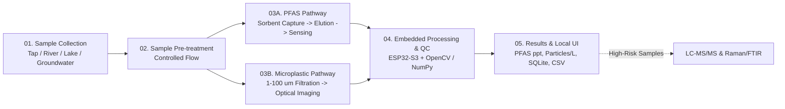

# Aqua-Sentinel

> **Demo Video:** [Watch the Aqua-Sentinel Prototype & Walkthrough Video](https://youtu.be/JCftjP8YXm0?si=8pnjrLnG4dx0qEce)
>
> **Repository:** https://github.com/HarshPrajapati7/Aqua-Sentinal

**Field-Portable Screening System for Emerging Contaminants (PFAS & Microplastics) in Drinking Water Sources and Water Supply Systems**

| Field | Details |
|---|---|
| **Event** | Smart India Hackathon (SIH) 2026 |
| **Problem Statement ID** | SIH26252 |
| **Problem Statement** | Development of Field Test Kits for Detection and Monitoring of Emerging Contaminants (PFAS, Microplastics, etc.) in Drinking Water Sources and Water Supply Systems |
| **Theme** | Clean & Green Technology |
| **Category** | Hardware |
| **Team Name** | Star Busters |
| **Team ID** | 143160 |

---

## Overview

**Aqua-Sentinel** pairs a reusable, field-portable electronic reader with replaceable, sample-contact cartridges to screen dissolved PFAS (PFOA, PFOS, PFHxS, GenX, and related targets) and particulate microplastics (1 to 100 um) from drinking water sources, treatment plants, rivers, groundwater, and household taps.

The dissolved-PFAS and particulate-microplastic pathways are separated to reduce cross-contamination and measurement artifacts. Every run records sample volume, timestamp, GPS location, cartridge identity, field/equipment blanks, and calibration status to assign a Quality Control verdict of `VALID`, `WARNING`, or `INCONCLUSIVE` and identify samples for confirmatory laboratory analysis using LC-MS/MS or Raman/FTIR.

---

## Key Innovations

- **Dual Separated Pathways:** Dissolved-PFAS enrichment and particulate membrane filtration are isolated.
- **Reusable Reader + Replaceable Cartridges:** Lower capital cost and repeatable field deployments.
- **Sorbent Preconcentration:** Target-specific sorbent capture supports PFAS enrichment and time-weighted monitoring.
- **Automated Optical Screening:** LED-illuminated membrane imaging quantifies particles/L, size distribution, and morphology.
- **Traceable Quality Control:** Blank verification, pixel-scale calibration, and filter-loading checks prevent false confidence.
- **Reference-Lab Grounding:** US EPA, ISO, and ASTM workflows guide frontline screening and confirmatory analysis.

---

## System Pipeline



---

## Hardware Architecture

### Core Modules

1. **Sample Handling:** Miniature peristaltic pump and inert tubing for metered flow.
2. **PFAS Preconcentration:** Replaceable sorbent cartridge for capture and controlled elution.
3. **Microplastic Filtration:** Membrane chamber for 1 to 100 um particles.
4. **Optical Imaging:** Microscope camera, objective lens, and PWM-controlled LED ring.
5. **Embedded Control:** ESP32-S3 controls fluidics, LED, ADS1115 acquisition, battery, and TFT.
6. **Edge Compute:** Laptop during the alpha build, with Raspberry Pi field-deployment support.
7. **Power:** Rechargeable 3S 18650 lithium-ion pack.

### ESP32-S3 Pin Mapping

| Subsystem | Signal | ESP32-S3 GPIO | Notes |
|---|---|---|---|
| Peristaltic Pump | PWM / IN1 / IN2 | GPIO 4 / 5 / 6 | 5 kHz PWM, timed dosing, 5-minute cutoff |
| Microscope LED Ring | PWM | GPIO 7 | Logic-level N-MOSFET |
| ADS1115 | SDA / SCL | GPIO 8 / 9 | I2C `0x48`, AIN0 to PFAS front-end |
| ILI9341 TFT | CS / MOSI / CLK / MISO / DC / RST | GPIO 10 / 11 / 12 / 13 / 14 / 15 | Local status display |
| Battery Monitor | VBAT Sense | GPIO 1 | 100k / 22k divider |

Firmware: `firmware/aqua_sentinel_esp32s3/aqua_sentinel_esp32s3.ino`

---

## Repository Structure

```text
Aqua-Sentinal/
├── README.md
├── firmware/
│   └── aqua_sentinel_esp32s3/
│       └── aqua_sentinel_esp32s3.ino
├── edge_pipeline/
│   ├── requirements.txt
│   ├── database.py
│   ├── microplastic_analyzer.py
│   └── controller.py
├── backend/
│   ├── package.json
│   └── server.js
└── frontend/
    └── src/
        └── App.jsx
```

---

## Technology Stack

| Layer | Technologies |
|---|---|
| Embedded Firmware | ESP32-S3, Arduino C++, ArduinoJson, Adafruit ADS1X15, Adafruit ILI9341 |
| Edge Compute & Vision | Python 3.10+, OpenCV, NumPy, PySerial |
| Local Storage | SQLite |
| Local API & UI | Node.js, Express, `better-sqlite3`, React |
| Optional Deployment | Docker, Firebase, Google Cloud |

---

## Getting Started

### 1. Flash ESP32-S3 Firmware

Open `firmware/aqua_sentinel_esp32s3/aqua_sentinel_esp32s3.ino` in Arduino IDE with ESP32 board package 3.x.

Install:
- `ArduinoJson`
- `Adafruit ADS1X15`
- `Adafruit GFX Library`
- `Adafruit ILI9341`

Select **ESP32S3 Dev Module** and upload.

### 2. Set Up the Python Edge Pipeline

```bash
cd edge_pipeline
python -m venv .venv
source .venv/bin/activate
pip install -r requirements.txt
```

Run a hardware-free simulation:

```bash
python controller.py \
  --simulate \
  --sample-id AS-0423 \
  --cartridge-id PFAS-LOT26-04 \
  --source-type "River/Lake" \
  --location "River Site A" \
  --volume-ml 500
```

Run with physical hardware:

```bash
python controller.py \
  --port /dev/ttyACM0 \
  --camera 0 \
  --px-per-um 0.8 \
  --sample-id AS-0424 \
  --cartridge-id PFAS-LOT26-05 \
  --volume-ml 500
```

### 3. Launch the Local API

```bash
cd backend
npm install
npm start
```

Integrate `frontend/src/App.jsx` into a Vite/React project and start the dashboard. The UI reads `http://localhost:4000/api/runs` and exports particle CSV files.

---

## Serial Control Protocol

All commands use newline-delimited JSON at 115200 baud.

| Command | Example Payload | Function |
|---|---|---|
| `PING` | `{"cmd":"PING"}` | Verify device health and battery |
| `SET_CARTRIDGE` | `{"cmd":"SET_CARTRIDGE","cartridge_id":"LOT26-04"}` | Bind cartridge and require blank |
| `RUN_BLANK` | `{"cmd":"RUN_BLANK"}` | Verify baseline and noise |
| `START_PUMP` | `{"cmd":"START_PUMP","volume_ml":500,"pwm":200}` | Dose sample volume |
| `SET_LED` | `{"cmd":"SET_LED","pwm":200}` | Set illumination |
| `READ_PFAS` | `{"cmd":"READ_PFAS"}` | Read blank-corrected PFAS result |
| `SET_CALIBRATION` | `{"cmd":"SET_CALIBRATION","flow_ml_min":120,"slope":0.85}` | Update calibration |
| `ABORT` | `{"cmd":"ABORT"}` | Stop pump and LED |

---

## Quality Control

| Risk | Mitigation |
|---|---|
| PFAS background contamination | Mandatory blank runs and wetted-material screening |
| Cross-reactivity | Matrix and analyte validation against LC-MS/MS |
| False particle identification | Raman/FTIR referral for elevated or ambiguous results |
| Filter clogging | Fixed-volume dosing and filter-loading warning above 35% |
| Calibration drift | Store pixel scale and blank baseline per run |

---

## Build & Validation Roadmap

1. **Bench Build:** Calibrate microscope scale and establish repeatable membrane handling.
2. **PFAS Capture Study:** Benchmark sorbent recovery, elution, and cartridge blanks.
3. **Reader Integration:** Combine ESP32-S3 control with image analysis and dashboard.
4. **Validation:** Run blinded spike-recovery and matrix-effect trials.
5. **Field Pilot:** Deploy across households, treatment facilities, rivers, and industrial sites.

---

## Impact & Applications

- Household point-of-use screening
- Water-treatment intake and effluent monitoring
- Watershed contamination mapping
- Industrial discharge checks
- Prioritization of high-risk samples for confirmatory laboratory testing

---

## Research & Reference Methods

1. US EPA PFAS Drinking Water Laboratory Methods - https://www.epa.gov/pfas/epa-pfas-drinking-water-laboratory-methods
2. US EPA (2025), Collection and Analysis for the PFAS National Primary Drinking Water Regulation - https://www.epa.gov/system/files/documents/2025-06/sampling-for-pfas-npdwr-june25.pdf
3. US EPA, PFAS Analytical Methods Development and Sampling Research - https://www.epa.gov/water-research/pfas-analytical-methods-development-and-sampling-research
4. US EPA, Clean Water Act Analytical Methods for PFAS - https://www.epa.gov/cwa-methods/cwa-analytical-methods-and-polyfluorinated-alkyl-substances-pfas
5. Pulster et al. (2024), USGS Guide to PFAS Sampling - https://doi.org/10.3133/ofr20241001
6. Rothstein et al. (2024), Ultra-Sensitive PFAS Detection Using SERS and Machine Learning - https://doi.org/10.1039/D4SD00052H
7. LeBarron et al. (2025), Electrochemical Sensing of PFAS - https://doi.org/10.1149/2754-2726/ade79d
8. Portable Electrochemical Sensors for PFAS - https://doi.org/10.1016/j.coelec.2025.101725
9. Chugh, Gaskin and Zhang (2026), Emerging Techniques for PFAS Detection - https://doi.org/10.1039/D5SD00166H
10. Cheng et al. (2025), Dual-Functional Imprinted Polymer for PFAS Detection - https://doi.org/10.1016/j.jhazmat.2025.138422
11. ISO 18127:2026, Organofluorine and Halogen in Water - https://www.iso.org/standard/85176.html
12. Faber et al. (2025), Complementary Organofluorine Analysis - https://doi.org/10.1021/acs.est.5c05079
13. WHO (2019), Microplastics in Drinking-Water - https://www.who.int/publications/i/item/9789241516198
14. US EPA (2023), Assessing Methods of Measuring Microplastics in Water - https://www.epa.gov/sciencematters/assessing-methods-measuring-microplastics-water
15. US EPA, Microplastics Research - https://www.epa.gov/water-research/microplastics-research
16. ISO 16094-2:2025, Analysis of Microplastic in Water - https://committee.iso.org/standard/84460.html
17. ISO 24187:2023, Principles for Microplastics Analysis - https://www.iso.org/standard/78033.html
18. ASTM D8332-20, Collection of Water Samples for Microplastic Analysis - https://store.astm.org/d8332-20.html
19. Schymanski et al. (2021), Micro-Raman and Micro-IR Analysis of Microplastics - https://doi.org/10.1007/s00216-021-03498-y
20. Blevins et al. (2021), Field-Portable Microplastic Sensing - https://doi.org/10.3390/s21103532
21. Kanwal et al. (2026), Portable Raman for Microplastic Monitoring - https://doi.org/10.1016/j.scitotenv.2026.182100
22. Hyperspectral Imaging for Irregular-Shaped Microplastics - https://doi.org/10.1016/j.scitotenv.2024.173811
23. Holographic Imaging and Machine Learning for Microplastic Analysis - https://doi.org/10.1016/j.emcon.2025.100558
24. Zhao et al. (2025), Microfluidic Microwave Sensing for Microplastics - https://doi.org/10.1016/j.sna.2024.116154
25. Shruti et al. (2022), Nile Red Analysis of Microplastics - https://doi.org/10.1016/j.jhazmat.2021.127171
26. PFAS Time-Weighted Passive Samplers - https://doi.org/10.1016/j.watres.2026.125918
27. Acoustofluidic Trap for Microplastic Separation - https://doi.org/10.1016/j.seppur.2026.137713

---

## Team

Built by **Team Star Busters** (Team ID: `143160`) for **Smart India Hackathon 2026 (SIH26252)**.
